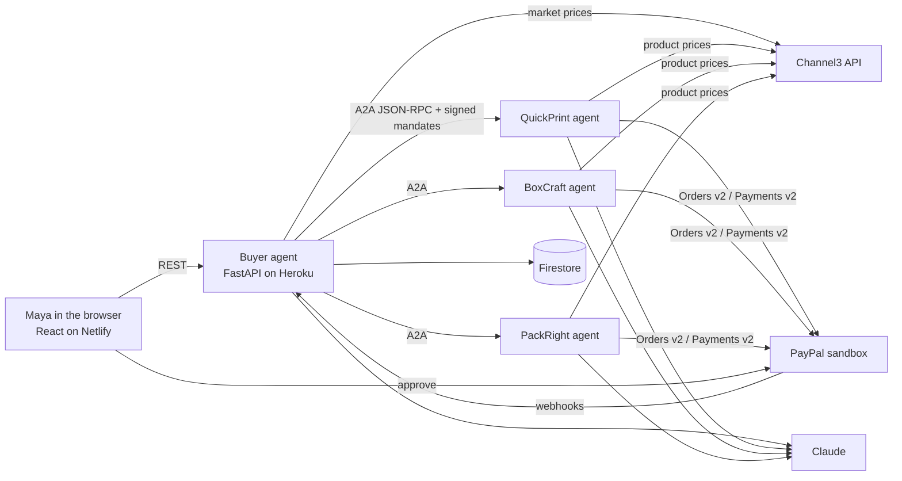

# Mandate

**A buying agent you can trust with your money.** You tell it what you need and what it's allowed to spend. It negotiates with independent seller agents, pays through PayPal only with your approval, and keeps the money on hold until your order arrives in good shape.

Built for the PayPal "Build What's Next with PayPal and AI" hackathon.

## The story

Maya runs a bakery and needs 200 branded cake boxes for an event.

**When it goes right**
1. She types: *"200 cake boxes with my logo, delivered by Nov 28. Budget $600. Ask me before paying anything over $400."*
2. Her agent turns that into a **signed intent mandate** (budget, approval limit, deadline).
3. It discovers seller agents through their published **A2A agent cards**, checks real market prices on **Channel3**, and requests quotes.
4. It drops a seller that can't meet the deadline and negotiates the others down, citing real market data and real competing offers.
5. The winning seller signs a **cart mandate**. The total is over Maya's $400 limit, so the agent asks her.
6. Maya approves in **PayPal**. The order uses `intent=AUTHORIZE`: the money is **held, not taken**.
7. The boxes arrive, she taps "Received, looks good", and only then is the payment **captured**.

**When it goes wrong**
1. 60 boxes arrive crushed and the logo is crooked on the rest. Maya reports it, with photos.
2. Claude assesses the evidence: 60 unusable, a minor cosmetic defect on the rest.
3. Because the money is still on hold, Maya's agent has the leverage. It negotiates with the seller agent, rejects a reprint that would arrive after her event, and settles on paying for usable units only.
4. PayPal makes a **partial capture with `final_capture: true`**: the seller gets the agreed amount, the rest of the hold is released back to Maya the same day.
5. If the seller refuses, the agent prepares a complete dispute file: both mandates, the agreed terms, the evidence and the full negotiation log.
6. The seller's reliability score drops, and future negotiations take it into account.

## Why it's real agent-to-agent commerce

- **Independent agents with private information.** The buyer knows Maya's budget; each seller knows its own cost and lowest price. Neither can see the other's. Outcomes aren't scripted: change the model or the market and the deal changes.
- **A real agent protocol.** Sellers publish A2A agent cards at `/.well-known/agent-card.json` and accept JSON-RPC `message/send`. Any third-party seller agent that speaks the same messages can join by adding its URL to `SELLER_AGENT_URLS`.
- **AP2-style signed mandates.** Intent, cart, payment and release mandates are signed with Ed25519. Sellers refuse to create a PayPal order, or capture money, without a valid signature from the buyer agent, and the buyer verifies the seller's cart signature with the key in its agent card.
- **Money goes to the seller's own PayPal account.** Each seller agent can have its own PayPal sandbox business account and REST app.
- **Hard limits live in code, not the prompt.** Sellers can't go below their floor, the buyer can't accept above the budget, nobody can capture more than was authorized.

## Architecture



The three seller agents run in the same Heroku app to save cost, each at its own URL with its own keys, PayPal credentials and private state. They talk to the buyer only over HTTP, exactly as a separately hosted agent would.

## PayPal capabilities used

| Capability | Where |
|---|---|
| Orders v2, `intent: AUTHORIZE` | Seller creates the order for the signed cart |
| Buyer approval (`payer-action` link) | Maya approves in PayPal's own page |
| Authorize order | Funds held on approval |
| Capture authorization | Full capture on confirmed delivery |
| Partial capture with `final_capture` | Pay only for usable units, release the rest |
| Void authorization | Cancel without charging |
| Reauthorize | Renew holds after the 3-day honor period (up to day 29) |
| Webhooks + signature verification | Payment events appear in the live feed |

## How AI is used

Claude (`claude-sonnet-5-5` by default) powers every agent:

- **Mandate parsing:** plain language into budget, approval limit, deadline and requirements.
- **Buyer negotiation:** decides to accept, counter or walk away, and writes persuasive counter-offers grounded in Channel3 market data and real competing quotes.
- **Seller negotiation:** each seller has its own personality and private floor price.
- **Damage assessment:** reads the customer's photos and note, separates unusable units from cosmetic defects, and suggests a fair discount.
- **Dispute negotiation:** both sides negotiate a settlement.
- **Explanations:** "Why didn't you pick BoxCraft?" answered from the actual negotiation record.

Without an API key, the agents fall back to simple rule-based logic so the project still runs locally. The hosted demo uses Claude.

## Sponsor tools

- **Channel3:** real product and price data. Sellers price from the real market, and the buyer uses the same data as leverage.
- **AG Grid (AG Studio)** and **Bryntum:** spend dashboard and order/payment timeline (in progress).

## Run it locally

Requirements: Python 3.13, Node 22.

```bash
# Backend
cd backend
python -m venv .venv && source .venv/bin/activate
pip install -r requirements.txt
cp .env.example .env          # fill in keys, or set PAYPAL_MODE=mock to try without PayPal
uvicorn app.main:app --reload --port 8000

# Frontend (new terminal)
cd frontend
npm install
cp .env.example .env
npm start                     # http://localhost:3000
```

Tests (both user stories, end to end, PayPal mocked):

```bash
cd backend && pip install pytest && python -m pytest -q
```

## PayPal sandbox setup

1. Sign in at [developer.paypal.com](https://developer.paypal.com) and open **Testing Tools → Sandbox Accounts**.
2. Create a **Personal** account (Maya, the buyer) and up to three **Business** accounts (one per seller). Use US accounts and USD.
3. Under **Apps & Credentials → Sandbox**, create a REST app for each business account. Put its client ID and secret in `SELLER_<ID>_PAYPAL_CLIENT_ID/SECRET`, or one shared app in `PAYPAL_CLIENT_ID/SECRET`.
4. Optional: add a webhook pointing at `https://<your-heroku-app>/api/paypal/webhook` and set `PAYPAL_WEBHOOK_ID`.
5. When the app sends you to PayPal, sign in as the sandbox Personal account to approve.

**For judges:** sandbox buyer login details for the hosted demo are listed in the submission form.

## Deploy

**Backend on Heroku** (the backend lives in `backend/`):

```bash
heroku create mandate-api
heroku config:set PUBLIC_BASE_URL=https://mandate-api.herokuapp.com FRONTEND_URL=https://<your-site>.netlify.app \
  CORS_ORIGINS=https://<your-site>.netlify.app SIGNING_SEED=<random> CRON_SECRET=<random> \
  ANTHROPIC_API_KEY=... CHANNEL3_API_KEY=... PAYPAL_CLIENT_ID=... PAYPAL_CLIENT_SECRET=...
heroku config:set FIREBASE_CREDENTIALS_JSON="$(cat service-account.json)"
git subtree push --prefix backend heroku main
```

Add the **Heroku Scheduler** add-on with a job every few hours:

```bash
curl -X POST -H "X-Cron-Secret: $CRON_SECRET" https://mandate-api.herokuapp.com/api/internal/renew-holds
```

Use a Basic dyno during judging so the app doesn't sleep.

**Frontend on Netlify:** new site from the repo, base directory `frontend`, and environment variable `REACT_APP_API_URL=https://mandate-api.herokuapp.com`.

## API

| Method | Path | Purpose |
|---|---|---|
| POST | `/api/orders` | Create a mandate and start negotiating |
| GET | `/api/orders/{id}` | Order and live feed |
| POST | `/api/orders/{id}/approve` | Sign payment mandate, create PayPal order |
| POST | `/api/orders/{id}/paypal-return` | Authorize after PayPal approval |
| POST | `/api/orders/{id}/delivered` | Capture the full hold |
| POST | `/api/orders/{id}/report` | Report a problem (note + photos) |
| POST | `/api/orders/{id}/ask` | Ask the agent about the order |
| GET | `/agents/{id}/.well-known/agent-card.json` | A2A agent card |
| POST | `/agents/{id}` | A2A JSON-RPC endpoint |

## Roadmap

- AG Studio spend dashboard with agent-built widgets
- Bryntum timeline of orders, holds and renewals
- Auto-pay below the approval limit using PayPal vaulted payment methods
- PayPal's native AP2 support when it's available in sandbox

## License

MIT, see [LICENSE](LICENSE).
