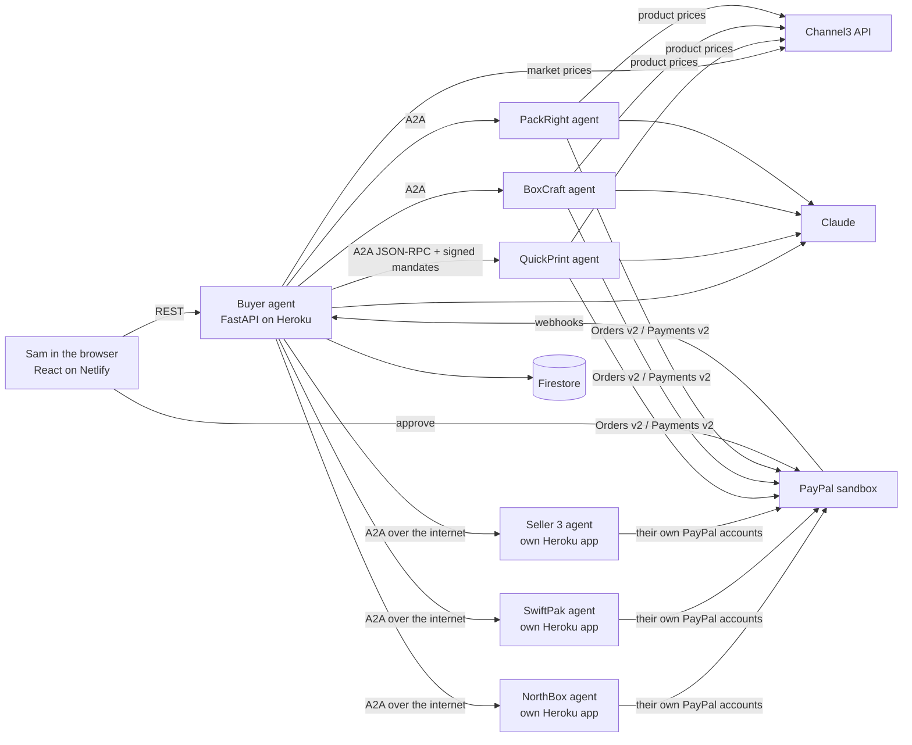

# Procuro

*Latin for "I act on your behalf", and the root of "procurement".*

**Send your agent to negotiate with theirs.** Seller agents run on their own servers. They meet your buying agent over **A2A**, every deal is signed with **AP2**, and **PayPal** holds the money until the goods arrive in good shape.

Built for the PayPal "Build What's Next with PayPal and AI" hackathon.

## Live demo

| | |
|---|---|
| **App** | **https://pro-curo.netlify.app** |
| Buying agent (backend) | https://paypal-app-backend-7e86f6c037ac.herokuapp.com ([health](https://paypal-app-backend-7e86f6c037ac.herokuapp.com/health), [A2A card](https://paypal-app-backend-7e86f6c037ac.herokuapp.com/agents/buyer/.well-known/agent-card.json)) |
| Outside seller 1: NorthBox Packaging | https://seller-agent-1-0e2b7ba38ac8.herokuapp.com ([A2A card](https://seller-agent-1-0e2b7ba38ac8.herokuapp.com/.well-known/agent-card.json)) |
| Outside seller 2: SwiftPak | https://seller-agent-2-0e65e0a8c585.herokuapp.com ([A2A card](https://seller-agent-2-0e65e0a8c585.herokuapp.com/.well-known/agent-card.json)) |
| Outside seller 3 | https://seller-agent-3-0171a2f20bcb.herokuapp.com ([A2A card](https://seller-agent-3-0171a2f20bcb.herokuapp.com/.well-known/agent-card.json)) |

Each outside seller's home page shows its own side of every conversation with the buying agent. Everything runs on the PayPal **sandbox**; sandbox login details for judges are in the submission form.

**Why it matters.** Small business owners spend roughly four to seven hours a week buying supplies and on the paperwork around it ([Walmart Business research via the U.S. Chamber of Commerce, 2026](https://www.uschamber.com/co/co-100/how-smarter-supply-purchasing-can-help-small-businesses-save-time-and-grow)). McKinsey estimates AI agents could run up to $1 trillion of US retail by 2030 ([Digital Commerce 360, 2025](https://www.digitalcommerce360.com/2025/10/20/mckinsey-forecast-5-trillion-agentic-commerce-sales-2030/)). When agents buy from agents, the money needs rules both sides can check.

## The story

Sam runs a small coffee shop and needs 1,000 paper coffee cups with lids for a weekend festival.

**When it goes right**
1. He types: *"1,000 12 oz paper coffee cups with lids, delivered by Nov 28. Budget $600. Ask me before paying anything over $400."*
2. He confirms his rules, and Procuro signs them as **AP2 v0.2 open mandates**: what may be bought (the item, the quantity, which sellers) and what his agent may pay on its own (up to his limit, only with PayPal).
3. It discovers seller agents through their published **A2A agent cards**, checks real market prices on **Channel3**, and requests quotes.
4. It drops a seller that can't meet the deadline and negotiates the others down, citing real market data and real competing offers.
5. The winning seller signs an **AP2 checkout** (an ES256 JWT) that must fit his rules. The total is over Sam's $400 limit, so the agent asks him.
6. Sam approves in **PayPal**. The order uses `intent=AUTHORIZE`: the money is **held, not taken**.
7. The cups arrive, he taps "Received, looks good", and only then is the payment **captured**.

**When it goes wrong**
1. A case of 200 cups arrives crushed and some lids on the rest don't fit. Sam reports it, with photos.
2. Claude assesses the evidence: 200 unusable, a minor defect on the rest.
3. Because the money is still on hold, Sam's agent has the leverage. It negotiates with the seller agent, rejects a replacement that would arrive after his festival, and settles on paying for usable units only.
4. PayPal makes a **partial capture with `final_capture: true`**: the seller gets the agreed amount, the rest of the hold is released back to Sam the same day.
5. If the seller refuses, the agent prepares a complete dispute file: both mandates, the agreed terms, the evidence and the full negotiation log.
6. The seller's reliability score drops, and future negotiations take it into account.

## Why it's real agent-to-agent commerce

- **Independent agents with private information.** The buyer knows Sam's budget; each seller knows its own cost and lowest price. Neither can see the other's. Outcomes aren't scripted: change the model or the market and the deal changes.
- **A real agent protocol.** Sellers publish A2A agent cards at `/.well-known/agent-card.json` and accept JSON-RPC `message/send`.
- **Seller agents outside Procuro.** [`seller-agent/`](seller-agent) is a separate app built on the official A2A Python SDK (`a2a-sdk` 1.3, A2A v1.0 with v0.3 compatibility). Three copies run on their own Heroku apps, each with its own name and pricing: **NorthBox Packaging**, **SwiftPak** and a third seller (see [Live demo](#live-demo)).
  - Each has its own signing key, its own PayPal sandbox account and its own storage.
  - It trusts only the keys the buying agent publishes in its A2A card.
  - Procuro finds them through `SELLER_AGENT_URLS` and negotiates, checks out (AP2) and pays them exactly like its own sellers. They're marked "outside" in the chat, with links to their agent card and to their own page showing their side of every conversation. If one can't be reached or doesn't quote, the chat says why.
  - Procuro can't read their PayPal accounts, so the receipt asks each one over A2A what PayPal shows.
- **The Agent Payments Protocol (AP2) v0.2, built with Google's AP2 SDK.** The SDK is vendored from [google-agentic-commerce/AP2](https://github.com/google-agentic-commerce/AP2) in `backend/vendor/ap2`; the mapping is in `backend/app/mandates.py`.
  - **Open mandates.** Sam's rules become an open checkout mandate and an open payment mandate (SD-JWT, ES256). Procuro's own screen signs them as his trusted surface. They bind the buying agent's key (`cnf`).
  - **Checkout.** The seller signs a Checkout JWT, and it must pass the AP2 constraint check against his open checkout mandate.
  - **Approval.** Checkout and payment are approved with closed mandates that carry the checkout's hash:
    - under his limit, the agent signs them itself on top of his open mandates (AP2 "human not present", SD-JWT delegation with nonce and audience);
    - above it, he taps Approve and his trusted surface signs them ("human present").
  - **Seller checks.** The seller verifies all of it in code before creating the PayPal order. It answers with signed checkout and payment receipts, or a signed error receipt. For example, the agent trying to pay more than his limit on its own gets `unresolved_constraint`, and no PayPal order is made.
  - **Over A2A.** Documents travel under AP2's keys (`ap2.mandates.CheckoutMandateSdJwt`, `ap2.mandates.PaymentMandateSdJwt`, `ap2.checkout`, `ap2.PaymentReceipt`). The merchant returns them as an A2A task artifact.
  - **Procuro extensions.** AP2 doesn't cover capturing later or moving a delivery. Those are separate signed Procuro extensions (ES256 JWTs) and are labelled that way: the buying agent's release instruction, and the seller's signed change of delivery date.
- **A receipt anyone can check.** Every order has a Receipt tab listing each signed AP2 document in order:
  - open checkout mandate
  - open payment mandate
  - seller's checkout
  - checkout and payment approvals
  - the seller's receipts
  - then any date change and the release

  For each document it shows who signed it, whether it checks out (verified with Google's AP2 SDK), its fingerprint, what it points to, and the PayPal order, authorization and capture it caused, with their `PayPal-Request-Id`s. Procuro also asks PayPal for its own record of the hold and the capture and compares the amounts with the signed ones. To re-check a downloaded receipt offline, run `python scripts/verify_receipt.py receipt-<order>.json` from the backend folder.
- **Money goes to the seller's own PayPal account.** Each seller agent can have its own PayPal sandbox business account and REST app.
- **Hard limits live in code, not the prompt.** Sellers can't go below their floor, the buyer can't accept above the budget, nobody can capture more than was authorized.

## Architecture



The three built-in seller agents run in the same Heroku app to save cost, each at its own URL with its own keys, PayPal credentials and private state. The outside sellers are separate apps on separate servers. All of them talk to the buyer only over HTTP.

## PayPal capabilities used

Every call goes through PayPal's official **Server SDK** (`paypal-server-sdk` 2.4.0): one client with OAuth handled by the SDK, the `orders`, `payments` and `vault` controllers, a timeout and retries. Every call that moves money carries a **`PayPal-Request-Id` built from what it does** (`create-<order>`, `auth-<order>`, `capture-<authorization>-<amount>`, `void-<authorization>`, `reauth-<authorization>`), so a retry after a lost answer gets PayPal's first answer back instead of a second order or a second capture. That makes POST safe to retry.

| Capability | Where |
|---|---|
| Orders v2, `intent: AUTHORIZE` | Seller creates the order for the signed cart |
| Buyer approval (`payer-action` link) | Sam approves on PayPal's own page (when PayPal isn't connected) |
| **Vault v3: setup token → payment token** | Sam connects PayPal once (`backend/app/wallet.py`) |
| **Orders v2 with `payment_source.paypal.vault_id`** | A seller holds the money in one call, no redirect: automatically under Sam's limit, or with one tap above it |
| Authorize order | Funds held on approval |
| Capture authorization | Full capture on confirmed delivery |
| Partial capture with `final_capture` | Pay only for usable units, release the rest |
| Void authorization | Cancel without charging, or settle at zero |
| Reauthorize | Renew holds after the 3-day honor period (up to day 29) |
| **Invoicing v2 via the PayPal Agent Toolkit** | Share a bulk order: the partner gets an itemized invoice with a pay link and QR code (`create_invoice`, `send_invoice`, `generate_invoice_qr_code`, `get_invoice`) |
| Webhooks + signature verification | Payment events appear in the live feed |

### Connect PayPal once (Vault v3)

On the start screen Sam connects PayPal once. PayPal returns a payment token that stays on the server, never in the browser. From then on:

- **Auto-pay inside the mandate.** A deal at or under the order's *ask me above* limit is held straight away, with no one present. The buying agent signs the closed AP2 checkout and payment mandates itself, on top of Sam's open mandates, so the seller can check the amount against the limit he signed (AP2's `payment.amount_range` constraint). A **monthly cap** applies on top, and auto-pay can be turned off.
- **One-tap approval above the limit.** Sam still has to approve, but it's one tap in the app instead of a trip to PayPal.
- **Still only a hold.** Nothing is captured until Sam confirms delivery or a settlement is agreed.
- **Disconnect** deletes the payment token at PayPal.

A Vault token can only be charged by the PayPal app that saved it. Sellers on the same app as Procuro (the default, one shared sandbox app) hold with it directly. A seller with its own separate PayPal app says so over A2A, and that order falls back to Sam approving on PayPal's page.

### Share a bulk order (PayPal Agent Toolkit)

Sam buys 1,000 cups at a negotiated bulk price and the bakery next door takes 300. From the order, his agent bills the bakery for exactly its share at the negotiated unit price with a real PayPal invoice: itemized, emailed by PayPal, with a pay link and a QR code. *Check for payments* asks PayPal which invoices are paid. The calls go through PayPal's **Agent Toolkit** (`PayPalAPI.run("create_invoice", …)`, the entry point its agent-framework adapters use). The toolkit's core is included unchanged in `backend/vendor/paypal_agent_toolkit` under its Apache-2.0 license, because the PyPI package pins `crewai-tools==0.13.2`, which no longer exists on PyPI (see `VENDORED.md`). In this sandbox the invoices come from Procuro's PayPal app account; in production they'd come from Sam's own business account.

## How AI is used

Claude (`claude-sonnet-5-5` by default) powers every agent:

- **Mandate parsing:** plain language into budget, approval limit, deadline and requirements.
- **Buyer negotiation:** decides to accept, counter or walk away, and writes persuasive counter-offers grounded in Channel3 market data and real competing quotes.
- **Seller negotiation:** each seller has its own personality and private floor price.
- **Damage assessment:** reads the customer's photos and note, separates unusable units from cosmetic defects, and suggests a fair discount.
- **Dispute negotiation:** both sides negotiate a settlement.
- **Explanations:** "Why didn't you pick BoxCraft?" answered from the actual negotiation record.
- **Spend analyst:** inside the AG Studio dashboard, a custom *Procuro Analyst* agent answers spending questions with real queries, reads any order's agent conversation, and delegates building charts to AG Studio's built-in agents. Studio's whole AI team runs on Claude through our own adapter.

Without an API key, the agents fall back to simple rule-based logic so the project still runs locally. The hosted demo uses Claude.

## Sponsor tools

- **Channel3:** real product and price data. Sellers price from the real market, and the buyer uses the same data as leverage. Claude filters the search results down to truly comparable listings and reads pack sizes before any per-unit price is computed.
- **AG Grid (AG Studio):** the **Spend** tab. See below.
- **Bryntum:** three views, all built from what the agents actually did.
  - **Calendar** (start screen): Sam clicks the day he needs the goods by. That date goes into his signed mandate and the agents negotiate against it. Upcoming deliveries and payment releases show on the same calendar. **He can drag a delivery to another day:** the drop waits while his agent asks that seller agent over A2A (`reschedule`). The seller decides from its own production schedule (an earlier date needs a free slot for its whole lead time), and if it agrees it signs a `cart_amendment` (new date, same price) that the buyer verifies. The delivery lands on the new day, and the payment release, the order's Gantt and the Sellers board follow; if not, it snaps back with the nearest date the seller can do. The PayPal hold is untouched, so nothing is paid twice, and a date past PayPal's 29-day hold limit is refused up front. The same request is on the order screen as "Need it on a different day?".
  - **Gantt** (each order's Timeline tab): the whole life of the order: deal, production, delivery, the PayPal hold, renewals, the 29-day limit, and when money is released or returned. His deadline is a red line; the seller's promise is a baseline next to what really happened.
  - **Scheduler** (the Sellers tab): one row per seller agent, a bar for every order it's preparing, coloured by where the money is (waiting for approval, on hold, paid, partly paid, in dispute). Each seller has a fixed number of production slots. When they're all booked (shaded), the seller's next quote moves to the first free day and says why, and the buying agent drops it if that misses Sam's deadline. The schedule drives the agents, not just the screen.

## The Spend dashboard (AG Studio)

One AG Studio report over four live tables from `GET /api/analytics`: orders, every offer made during negotiation, sellers, and PayPal money events (held, paid to seller, returned to you, hold renewed).

- **Themed as part of the app.** `frontend/src/dashboard/theme.js` maps every Studio, grid and chart parameter to Procuro's own design tokens, with a fixed series palette so money keeps its meaning across charts.
- **Two custom widgets** (`frontend/src/dashboard/widgets.js`), registered with `createWidgets` and listed under "Procuro" in the widget menu:
  - **Money status:** per seller or item, where the money is: on hold in PayPal (hatched yellow), paid to the seller (green), returned to you (blue). The same visual language as the order screen's money meter.
  - **Negotiation receipt:** each seller's first quote struck through next to the negotiated price and the percentage saved.
  Both use the widget API (`getData`, display states), so page filters, cross-filters and field remapping work like any built-in widget.
- **Two pages:** *Spend overview* (KPIs, both custom widgets, paid vs saved by month, outcomes, every order) and *Sellers and negotiation* (savings and problem rates, a concession curve of how far each seller moves per round, reliability scores, and a widget-filtered grid of problem orders).
- **Swapped-in harness: AG Studio's AI runs on Claude.** `claudeAdapter.js` implements Studio's `AgLlmAdapter`: it translates Studio's conversation, tools and JSON-schema output requests into Anthropic Messages calls and back into Studio's output items and AG-UI events. Calls go through `POST /api/studio-ai/messages`, which keeps the API key on the server, pins the model, caps output and rate-limits per client.
- **A custom agent talking to Studio's built-in agents.** `ai.js` makes *Procuro Analyst* the primary agent. It knows how mandates, negotiation and PayPal holds work, queries the data, reads a live order's real agent-to-agent conversation through a custom `get_order_story` tool, and delegates widget and page building to Studio's built-in lead, data, page, planning and widget agents (all on Claude too).
- **Real data only.** Every row is an order your agent actually negotiated and paid through PayPal, saved in Firestore. With no orders yet, the tab says so and links to placing one.

Layouts you edit are saved in your browser. *Ask the analyst* opens the AI panel next to the dashboard.

## Run it locally

Requirements: Python 3.11+, Node 22.

```bash
# Backend
cd backend
python -m venv .venv && source .venv/bin/activate
pip install -r requirements.txt
cp .env.example .env          # fill in keys, or set PAYPAL_MODE=mock to try without PayPal
uvicorn app.main:app --reload --port 8000

# Frontend (new terminal)
cd frontend
npm install
cp .env.example .env          # API URL, and optionally your AG Studio trial licence key
npm start                     # http://localhost:3000
```

Tests (both user stories end to end, the outside seller agent in-process, PayPal mocked; nothing calls real services):

```bash
cd backend && pip install -r requirements-dev.txt && python -m pytest -q
```

Handy scripts (run from `backend/`; each only shows what it would do until you add `--apply`):

| Script | What it does |
|---|---|
| `scripts/verify_receipt.py receipt-<order>.json` | Re-checks a downloaded receipt offline with Google's AP2 SDK |
| `scripts/seed_calendar_demo.py` | Adds a few demo orders so the calendar shows every colour (`--remove` deletes them) |
| `scripts/cleanup_sandbox_orders.py` | Cancels test orders that can never finish (stale or expired holds) |
| `scripts/delete_orders.py --through YYYY-MM-DD` | Deletes old orders, after writing a backup |
| `scripts/check_partner_signup.py` | Sandbox check of PayPal platform mode: seller sign-up link and a platform fee |

## Firebase setup (saving orders)

Without Firebase, orders live in memory and disappear when the server restarts (the Spend tab says so in red).

1. In the [Firebase console](https://console.firebase.google.com), create a project (Google Analytics not needed).
2. **Build → Firestore Database → Create database.** Pick **production mode**, which denies all direct access. Only the backend reads and writes, through the Admin SDK. For location, pick the region nearest your backend server (for example `nam5` if Heroku runs in the US). The location can't be changed later.
3. **Project settings → Service accounts → Generate new private key.** Save the JSON file *outside* this repo.
4. In `backend/.env`, paste the key file's contents after `FIREBASE_CREDENTIALS_JSON=`: either on one line, or the whole file wrapped in single quotes (`'{ ... }'`). Or set `FIREBASE_CREDENTIALS_PATH=` to the file's path instead.
5. Restart the backend. It writes a test document at startup; `http://localhost:8000/health` should show `"store": "firestore"`. If something's wrong, `store_error` says what.

**Damage photos.** Each photo's SHA-256 fingerprint goes into the dispute file. A compressed copy (max 1568 px, under 900 KB) is stored in Firestore, which works on the free Spark plan. To keep full-size originals instead, upgrade to the Blaze plan, create the default Storage bucket, and set `FIREBASE_STORAGE_BUCKET=<project-id>.firebasestorage.app`.

`firestore.rules` and `storage.rules` in the repo root deny all client access; paste them into the console's Rules tabs.

What's stored: `orders` (with each order's `messages`), `counters`, `sellers`, `seller_sessions` (each seller agent's private floor price), and `evidence`.

## PayPal sandbox setup

1. Sign in at [developer.paypal.com](https://developer.paypal.com) and open **Testing Tools → Sandbox Accounts**.
2. Create a **Personal** account for Sam, the buyer (first name Sam), and **Business** accounts for the sellers (e.g. QuickPrint Packaging, NorthBox Packaging, SwiftPak Supply). Use US accounts and USD.
3. Under **Apps & Credentials → Sandbox**, create a REST app for each business account. Put its client ID and secret in `SELLER_<ID>_PAYPAL_CLIENT_ID/SECRET`, or one shared app in `PAYPAL_CLIENT_ID/SECRET`.
4. In the sandbox app that `PAYPAL_CLIENT_ID` points to, under **Features**, turn on **Save payment methods** (Vault, for "Connect PayPal") and **Invoicing** (for sharing an order). Leave sellers without their own `SELLER_*` keys so they share this app and can use the saved PayPal.
5. Optional: add a webhook pointing at `https://<your-heroku-app>/api/paypal/webhook` and set `PAYPAL_WEBHOOK_ID`.
6. When the app sends you to PayPal (to connect, or to approve without a connected PayPal), sign in as the sandbox Personal account.

**For judges:** sandbox buyer login details for the hosted demo are listed in the submission form.

## Deploy

**Backend on Heroku** (the backend lives in `backend/`):

```bash
heroku create procuro-api
heroku config:set PUBLIC_BASE_URL=https://procuro-api.herokuapp.com FRONTEND_URL=https://<your-site>.netlify.app \
  CORS_ORIGINS=https://<your-site>.netlify.app SIGNING_SEED=<random> CRON_SECRET=<random> \
  ANTHROPIC_API_KEY=... CHANNEL3_API_KEY=... PAYPAL_CLIENT_ID=... PAYPAL_CLIENT_SECRET=...
heroku config:set FIREBASE_CREDENTIALS_JSON="$(cat service-account.json)"
git subtree push --prefix backend heroku main
```

Add the **Heroku Scheduler** add-on with a job every few hours:

```bash
curl -X POST -H "X-Cron-Secret: $CRON_SECRET" https://procuro-api.herokuapp.com/api/internal/renew-holds
```

Use a Basic dyno during judging so the app doesn't sleep.

**Frontend on Netlify:** new site from the repo, base directory `frontend`, and environment variables `REACT_APP_API_URL=https://procuro-api.herokuapp.com` and `REACT_APP_AG_STUDIO_LICENSE=<your AG Studio trial key>` (without a key, Studio shows a trial watermark).

## API

| Method | Path | Purpose |
|---|---|---|
| POST | `/api/orders` | Create a mandate and start negotiating |
| GET | `/api/orders/{id}` | Order and live feed |
| POST | `/api/orders/{id}/approve` | Sign payment mandate, create PayPal order |
| POST | `/api/orders/{id}/paypal-return` | Authorize after PayPal approval |
| POST | `/api/orders/{id}/delivered` | Capture the full hold |
| POST | `/api/orders/{id}/report` | Report a problem (note + photos) |
| POST | `/api/orders/{id}/ask` | Ask the agent about the order |
| GET | `/api/orders/{id}/evidence/{evidence_id}` | A damage photo (with its SHA-256 in `X-Content-SHA256`) |
| GET | `/api/orders/{id}/timeline` | The order's Gantt timeline |
| GET | `/api/calendar` | Deliveries and payments for the calendar |
| GET / PATCH / DELETE | `/api/paypal-wallet` | Saved PayPal: status, auto-pay and monthly cap, disconnect |
| POST | `/api/paypal-wallet/connect`, `/api/paypal-wallet/finish` | Connect PayPal once (Vault v3 setup token, then payment token) |
| GET | `/api/orders/{id}/receipt` | Every signed step with its fingerprint, signature check, chain link and PayPal records |
| GET | `/api/orders/{id}/receipt/paypal` | PayPal's own record of the hold and capture, compared with the signed amounts |
| POST | `/api/orders/{id}/reschedule` | Move a delivery: the buying agent asks the seller agent over A2A |
| POST | `/api/orders/{id}/shares`, `/api/orders/{id}/shares/refresh` | Share part of an order with a PayPal invoice; check which are paid |
| GET | `/api/sellers/schedule` | Seller agents' production schedules (Sellers board) |
| GET | `/api/analytics` | Tables for the Spend dashboard (real orders only) |
| POST | `/api/studio-ai/messages` | One AG Studio AI turn, answered by Claude |
| GET | `/agents/{id}/.well-known/agent-card.json` | A2A agent card |
| POST | `/agents/{id}` | A2A JSON-RPC endpoint |

## Roadmap

- PayPal's native AP2 support when it's available in sandbox (PayPal as the credential provider and payment processor signing its own receipts)
- **Platform mode.** Procuro as a PayPal platform for its sellers: tested in sandbox with `scripts/check_partner_signup.py` (partner-referral sign-up, then a $1.00 hold captured with a $0.10 `platform_fees` share for Procuro). Not wired into the app yet: a payment method saved with one PayPal app can't pay another merchant, so auto-pay across sellers needs PayPal to enable shared vaulting.

## License

MIT, see [LICENSE](LICENSE). The PayPal Agent Toolkit core in `backend/vendor/paypal_agent_toolkit` is PayPal's code under Apache-2.0 (its own `LICENSE` is in that folder). Google's AP2 SDK in `backend/vendor/ap2` is Apache-2.0 too (its `LICENSE` and `VENDORED.md` are in that folder).
